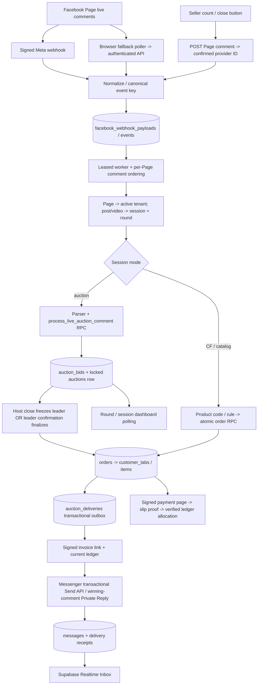

# Live Streaming & Auction Engine architecture audit

Audit date: 9 November 2026, Asia/Bangkok. Scope: the current local working tree, including existing uncommitted Messenger/Sync changes. No production database, Meta account, access tokens or deployed scheduler were accessed. Application code and schema migrations were not changed during this audit; only reports and isolated audit utilities were added.

**Deliverables and scope**

- [Complete relevant-file inventory](live-auction-files.md): **229 relevant/supporting files**, each with its responsibility, grouped by routes/components/libraries/migrations/tests/docs.
- [Keyword-hit CSV](live-auction-keyword-hits.csv) and [machine-readable index](live-auction-index.json): **1,129 source paths enumerated; 269 filename/content keyword hits plus 61 explicitly included dependency files; 101 broad incidental hits retained separately**. Search terms were `auction`, `bidding`, `poller`, `comments`, `winner`, `live_stream`, and `bid`, case-insensitive. Filename matches and referenced engine directories were included as well as content matches.
- Dependencies, build outputs, `.git`, provider caches, credentials/configuration secrets and the report directory itself were excluded. Broad `bid`/`comments` hits are not automatically auction code. Supporting-file summaries are derived from declarations/test names; behavioral conclusions below come from tracing executable paths.
- There are no matching dedicated auction hooks under `hooks/`. Polling hooks live inside the components. `components/inbox/useAuctionStatuses.ts` is the dedicated auction status hook.
- [Isolated reproductions](live-auction-reproductions.json), generated by `node reports/verify-live-auction-audit.cjs`, exercise the real parser and the complete registered SQL schema in PGlite. They read no `.env` files and send no messages.

**Architecture in one view**

This is a Next.js live-commerce control plane for Facebook Page broadcasts, backed by Supabase/PostgreSQL. It discovers existing Meta live videos and processes their comments. No RTMP ingest, HLS delivery, WebRTC room server or video encoder was found in the application directories. The database, rather than a browser timer or Node process, owns accepted bids, final prices, orders and ledger totals.

**1. Configuration and dashboard entrypoints**

The active `/live-auction` page is `app/(dashboard)/live-auction/page.tsx`: it loads the active tenant, Page profiles and tenant-owned bank accounts, then mounts `LiveSessionDashboard`. `/live-cf` exposes the adjacent product-code sales flow. The `live_cf` feature gate controls both; its present implementation is enabled by default unless explicitly disabled (`lib/feature-flags.ts`). A feature flag is not the tenant authorization boundary.

`/api/live-auction/workspace` coordinates the unified setup through `save_auction_workspace`; `/api/live-auction/session` configures session automation through `configure_auction_session`. `/api/live-cf/auction` retains the direct round CRUD interface. Owner/tenant checks live in `lib/features/commerce/auction-api.ts`; write operations there require a same-origin request. Database RPCs additionally validate active tenant/Page/bank ownership and protect money mutations.

**2. Comment ingestion and recovery**

| Path            | Actual behavior                                                                                                                                                                                                                                                                         | Principal files                                                                              |
| --------------- | --------------------------------------------------------------------------------------------------------------------------------------------------------------------------------------------------------------------------------------------------------------------------------------- | -------------------------------------------------------------------------------------------- |
| Webhook         | `/webhook`, `/api/webhook`, `/api/webhooks` and their `/facebook` aliases share GET verification and POST HMAC verification. The event is durably enqueued before HTTP 200; processing uses `after()` and a recovery worker.                                                            | `webhook-http.ts`, `webhook-envelope.ts`, route aliases                                      |
| Poll fallback   | `LiveCommentPoller` POSTs every **2.5 seconds plus request time** while mounted. Inactive/missing/failed video states slow it to 5–10 seconds. The server checks the selected session, reads latest 50 comments, normalizes them to `feed` events, enqueues and drains the same worker. | `components/live-cf/LiveCommentPoller.tsx`; `app/api/live-cf/auction/poll-comments/route.ts` |
| Seller controls | Host-action API posts a comment as the Page, obtains the provider comment ID, then enqueues it. An uncertain provider/enqueue outcome is not posted again automatically.                                                                                                                | `app/api/live-cf/auction/host-action/route.ts`                                               |
| Recovery        | Secret-authenticated `/api/cron/facebook-webhooks` drains webhook jobs and auction/customer-tab/shipping outboxes. Browser polling also drains jobs, but a browser is not a durable scheduler.                                                                                          | cron route; `webhook-worker.ts`                                                              |

Queue tables retain raw receipts, canonical event hashes, immutable receipt times, sequence numbers, attempts and lease tokens. Deduplication uses `(page_id,event_key)`. The comment ordering key is `comments:<pageId>`, so different bidders and host commands share one barrier. Claims/heartbeats/finish RPCs fence workers; `execution.once()` checkpoints potentially irreversible Graph calls. Unknown external-send outcomes become `requires_review`; they are not blindly retried. Exhausted/review events do not indefinitely block subsequent comments.

`webhook-handler.ts` resolves `tenants.page_id`, then invokes `onComment`. The latter obtains `facebook_comment_context`, honors session mode, canonicalizes post/video aliases, and routes auction comments before the appropriate product CF/catalog paths. A late bid belonging to a closed round is consumed as auction traffic instead of accidentally buying a CF product.

**3. Bid and CF parsing**

`lib/integrations/facebook/auction-comment-parser.ts` is the current parser; `auction-parser.ts` is only its compatibility re-export.

- Shared normalization is NFKC, trim, case folding, whitespace collapse and emoji variation-selector removal (`comment-config.ts`). Session settings take precedence over stored round snapshots, with defaults as a final fallback. Default confirmation tag is **`1`**; default closing tag is **`ปิด`**. Custom tags can change both.
- Hosts are the owning Page or a trusted `host_ids` entry. Host close/count tags are handled separately; host chatter does not become a bid.
- A buyer confirmation keyword becomes `CONFIRM_BID`, not an automatic increment. It only succeeds for the global current leader under a database row lock.
- Explicit `opening_tags` become `OPENING_BID`. The first accepted opening uses `start_price`; later openings are rejected as `already_opened`.
- Whole numeric prices match `^(?:\d{1,9}|\d{1,3}(?:,\d{3}){1,2})(?:\.\d{1,2})?(?:\s*บาท)?$`, are positive and at most 999,999,999. Examples: `500`, `1,250.50 บาท`. Embedded chatter such as `500 ลุ้น` does not match. Thai numeral glyphs are not converted to ASCII by this parser.
- PostgreSQL reparses numeric text through `auction_numeric_price`; TypeScript's supplied `p_amount` is not sufficient evidence of a valid price. Money uses `numeric`, not floating-point database columns.
- Initial minimum is `start_price`; later minimum is `current_price + min_step`. Any price meeting that minimum is allowed: steps are a minimum increase, not a mandatory multiple/grid. Equal-price later bids fail as `too_low`.
- The CF path is distinct: `cf-code.ts` extracts product codes and Thai/English purchase-intent prefixes, while live product/rule matching and order RPCs enforce product/variant/stock constraints. `handleLiveCfComment` builds public/private order replies and signed payment links. A product CF keyword should not be described as an auction price increment.

**4. Winner resolution, timing and compatibility**

The canonical migration order is `scripts/build-full-database-setup.cjs`. Reading only the first definition in `live-auctions.sql`, or an older design document, gives an incorrect architecture.

| Effective entrypoint                | Last explicit registered definition               | Role                                                                                                                      |
| ----------------------------------- | ------------------------------------------------- | ------------------------------------------------------------------------------------------------------------------------- |
| `process_live_auction_comment`      | `supabase/facebook-comment-configuration.sql:321` | Locks the round, validates Page/post/event, resolves current settings, processes host close/count or leader confirmation. |
| `process_live_auction_highest_bid`  | same file, line 212                               | Revalidates eligible numeric/opening bids, minimum price, source staleness and comment order; updates the leader.         |
| `finalize_live_auction_highest_bid` | same file, line 274                               | Creates the winner's order, cumulative tab association, local activity note and enabled notification jobs atomically.     |
| `finalize_live_auction`             | `supabase/live-auction-on-demand.sql:167`         | Compatibility close/cancel entrypoint with a separate `winnerFlow=on_demand` branch. See finding A3.                      |
| `claim_auction_bill_delivery`       | same file, line 32                                | Revision-aware atomic claiming for legacy claim-based bill deliveries.                                                    |

The installed definitions were also checked with `pg_get_functiondef` in the isolated compiled-schema reproduction; this matters because older migrations dynamically preserve/rewrite functions.

The effective normal flow has two finalization triggers: a leader can submit a configured confirmation tag while the round is active, or a trusted host first closes it and sets `winner_locked_at`, after which only the frozen leader can confirm. Confirmation creates the order and closes the round. A nonleader's `1` returns `not_winner`. The `winnerFlow` field and claim tables retain compatibility with older on-demand billing, but current top-level confirmation is based on the global leader, not every bidder's individual maximum.

**No automatic auction end timestamp, time-extension/anti-sniping rule or timestamp-based equal-price tie-breaker was found.** The 2.5/3/5-second timers are polling timers. Counting tags change `host_count`; they are not a server countdown. The first equal-price bid processed wins the equality case because the next bidder must clear `min_step`. Ordering is queue insertion sequence, not a guarantee of Meta comment creation chronology.

**5. Post-auction billing, payments and frontend state**

The finalizer inserts an `orders` row with `source=live_auction`. Order triggers attach it to the session/customer tab and recalculate totals with row locks. `customer_tabs` combines multiple auction/CF orders per session/customer, tracks shipping once, allocates verified payments and exposes generated `remaining_amount`/`credit_amount`. Local activity notes do not fabricate customer inbound messages or renew Messenger eligibility.

`deliverAuctionNotifications()` reads pending outbox rows, checks current auction/claim revision and switches, claims sending atomically, reads the current tab ledger and builds the signed payment destination. It prioritizes private jobs within the fetched batch. `sendAuctionInvoiceWithReceipt()` tries the transactional tag, handles a definitive unsupported-tag response, and can use the winning comment's Private Reply for eligible definite session/window rejections. Network ambiguity does not authorize another send. Provider receipts/status are stored in `messages`. Older split invoice plans retain progress; outside-window first contact is collapsed into a complete invoice/link so the one private reply is not wasted on an incomplete greeting.

Payment URLs are HMAC-signed through `live-cf-payment-link.ts`; the public `/pay/live/[token]` routes verify scope and show the current tab/order. Slip processing is claimed and deduplicated; `customer_tab_payments` has unique slip/transaction references and orders are paid through verified ledger allocation or authorized manual review. Reminder workers reread balance and messaging policy before dispatch and use durable message keys. Their automation policy is separate from the manual transactional invoice endpoint.

The auction console itself primarily **polls**: round panel around 3 seconds, session dashboard around 5 seconds, and Inbox auction badges around 5 seconds in bounded batches. The Inbox message stream separately uses Supabase Realtime `messages` INSERT/UPDATE, with local selection by `customer_id`. There is no Socket.io/Pusher auction-room server in the traced path. Public stock subscriptions are an adjacent inventory concern.

**6. Database map**

| Table(s)                                                                         | Responsibility and important constraints                                                                                                                                                                    |
| -------------------------------------------------------------------------------- | ----------------------------------------------------------------------------------------------------------------------------------------------------------------------------------------------------------- |
| `tenants`, `tenant_members`, `bank_accounts`                                     | Active Page ownership, staff/owner access, tenant Page token and allowed destination bank.                                                                                                                  |
| `facebook_webhook_payloads`                                                      | Durable raw receipts; payload SHA-256 and delivery counts.                                                                                                                                                  |
| `facebook_webhook_events`                                                        | Page/event deduplication, ordering sequence, status, backoff and fenced worker leases.                                                                                                                      |
| `facebook_webhook_steps`                                                         | Per-event persistence/external-side-effect checkpoints.                                                                                                                                                     |
| `live_sessions`                                                                  | Tenant + Page + live post scope; mode, current automation/settings, finance and ended state; unique `(tenant_id,page_id,live_post_id)`.                                                                     |
| `auctions`                                                                       | Round item, opening/min-step/current prices, leader/comment/host IDs, lifecycle, winner lock/confirmation and order link. Unique active round per `(page_id,live_post_id)`.                                 |
| `auction_bids`                                                                   | Accepted/rejected/host/confirmation audit rows with cached result. Unique `event_id` and `(auction_id,comment_id)`. No separate generic `bids` table was found for this engine.                             |
| `auction_winner_claims`                                                          | Historical/compatibility per-bidder claim, order and revision state; unique `(auction_id,bidder_id)`.                                                                                                       |
| `auction_deliveries`                                                             | Transactional notification outbox, public/private channel, status and send progress. Legacy uniqueness `(auction_id,channel)` and claim uniqueness `(claim_id,claim_revision,channel)` are partial indexes. |
| `orders`                                                                         | Live-auction/CF sale rows and payment status; links to round/session/customer tab.                                                                                                                          |
| `customer_tabs`, `customer_tab_items`                                            | Cumulative per-session/customer ledger and order line items. Unique `(live_session_id,customer_id)`; order ID is the tab-item primary key.                                                                  |
| `customer_tab_payments`, `customer_tab_slip_attempts`                            | Verified payment allocations, transaction/slip uniqueness and image-hash duplicate detection.                                                                                                               |
| `auction_payment_proofs`, `slips`                                                | Legacy order proof references and shared verification/manual-review evidence.                                                                                                                               |
| `customer_tab_reminders`, `live_reminder_dispatch_slots`                         | Leased reminder jobs and controlled dispatch slots.                                                                                                                                                         |
| `auction_session_requests`, `auction_workspace_requests`, `live_session_changes` | Durable request IDs, actor/input/result records and idempotent configuration/finance changes.                                                                                                               |
| `live_session_customer_notes`                                                    | Session-scoped customer annotations with revision checks.                                                                                                                                                   |
| `products`, `commerce_variants`, `comment_rules`, `live_cf_webhook_receipts`     | Adjacent CF stock/product rules and comment-to-order deduplication.                                                                                                                                         |
| `customers`, `messages`, `conversation_reads`                                    | Page-scoped customer mapping, Inbox transcript/status and staff read state. No independent generic `conversations` table is required by this path.                                                          |

Auction/ledger/queue tables are RLS-enabled and generally revoked from browser roles; authorized server routes use service-role operations and restricted RPCs. This is a deliberate server authorization boundary. The schema bundles are generated: new fixes should be appended as forward migrations rather than editing already-applied source checksums.

**7. Audit findings and recommended changes**

Priority meanings: P1 can affect sale correctness or miss live bids; P2 affects availability, scale or operating clarity. A source-confirmed risk is not a claim that production has already experienced it.

| ID  | Priority / evidence                               | Finding and trigger                                                                                                                                                                                                                                                                                                                                                                                                                                                | Recommended fix                                                                                                                                                                                                                                                                                                     |
| --- | ------------------------------------------------- | ------------------------------------------------------------------------------------------------------------------------------------------------------------------------------------------------------------------------------------------------------------------------------------------------------------------------------------------------------------------------------------------------------------------------------------------------------------------ | ------------------------------------------------------------------------------------------------------------------------------------------------------------------------------------------------------------------------------------------------------------------------------------------------------------------- |
| A1  | **P1, reproduced**                                | `app/api/live-cf/auction/host-action/route.ts:60` publishes `❌` for every close action. Configured/default close tag may be `ปิด` or another value. The real parser returns `IGNORE` for the published comment, so the API can say queued while the auction remains active. Count buttons similarly publish literal digits rather than resolving custom count tags.                                                                                               | Resolve the same current session settings used by TS/SQL, map the selected action to an enabled configured tag, and verify the resulting command parses as that host action before posting. Test default, custom and disabled controls end-to-end.                                                                  |
| A2  | **P1, reproduced**                                | Current `process_live_auction_comment` at `supabase/facebook-comment-configuration.sql:321` checks queue receipt time (`e.created_at`) but not source `value.created_time` before confirmation/host control. A delayed `1` from the current leader, created an hour before the new round, was accepted as `confirmed` and created an order in the compiled-schema reproduction. The numeric-bid delegate has a source-time guard, so protection differs by intent. | Add a shared source-event-time eligibility guard before _every_ mutating intent, including confirmation and close/count. Normalize ISO/seconds/milliseconds consistently; reject/quarantine stale/untrusted timestamps. Test delayed confirmations/host comments across adjacent rounds and same-second boundaries. |
| A3  | **P1, reproduced for compatibility close API**    | `/api/live-cf/auction/close` calls `finalize_live_auction`. Its `on_demand` branch at `live-auction-on-demand.sql:167` closes the round without an order and without `winner_locked_at`. The current wrapper then refuses a later confirmation because the closed round is not winner-locked. Reproduction ends `closed`, `winner_locked_at=null`, `order_id=null`. The normal console's host-comment path has a different transition.                             | Unify direct close and host-comment close in one authoritative RPC/state machine. Either freeze the winner with `winner_locked_at` and await confirmation, or finalize immediately according to an explicit policy. Preserve cancel behavior and idempotent order creation.                                         |
| A4  | **P1, source-confirmed fallback limitation**      | Poll API at `poll-comments/route.ts:124–130` reads only latest **50** reverse-chronological comments and never follows paging. When webhooks are absent and >50 unseen comments accumulate between successful polls, older unseen bids can fall out of the window permanently.                                                                                                                                                                                     | Keep a durable per-session ingestion high-water mark; paginate/catch up to it, with overlap and event-key deduplication. Alert when catch-up is incomplete. Test bursts >50, downtime and missing authors.                                                                                                          |
| A5  | **P1, source-confirmed conditional routing risk** | On Graph error 100, `poll-comments/route.ts:139–163` may attach the Page's sole different active live video as an alias of the existing round. If an old selected session/video is inaccessible and a new unrelated live is running with no owning round yet, its comments can be routed into the old item's auction.                                                                                                                                              | Only alias IDs after proving they identify the same canonical video/post. Otherwise require explicit operator selection of a new session/round; do not infer sale identity merely from “one active live”.                                                                                                           |
| A6  | **P2, concurrency/latency risk**                  | Page-wide `comments:<pageId>` ordering prevents bidder/host overtaking, but also serializes independent sessions on the Page. `webhook-worker.ts:172` awaits the whole handler, and winner handling drains Graph notification outbox work inline (`auction-server.ts`). Slow Meta calls can delay later bid ingestion for that Page.                                                                                                                               | Keep the price/winner transaction fast and enqueue all external sends; run independently leased notification workers. If sharding ordering by verified canonical live ID, preserve cross-alias deduplication and the host-close barrier. Test with simultaneous lives and slow Graph responses.                     |
| A7  | **P2, rate/load bottleneck**                      | Browser fallback runs up to about 24 requests/minute/tab, while `poll-comments/route.ts:63` allows 40/minute per tenant/actor. Two fast tabs can approach 48/minute; multiple actors multiply Page Graph traffic. Round/session/badge polling adds DB load. Instance-local `seen` is not a distributed cache.                                                                                                                                                      | Use a tenant/Page/session leader lease and shared short-lived poll cache; followers consume the same result. Apply provider-aware backoff with jitter and aggregate rate budgets. Preserve DB deduplication as authority.                                                                                           |
| A8  | **P2, ordering semantics to make explicit**       | Numeric ties are rejected after the first accepted queue event, not adjudicated by Meta creation timestamp. Webhook and poll arrivals can interleave; reversing one 50-comment response does not establish global creation order.                                                                                                                                                                                                                                  | Document receipt-order fairness or introduce a bounded source-time reorder window with a deterministic secondary key before the close barrier. Do not sort only one transport while claiming global timestamp fairness.                                                                                             |
| A9  | **P2, deployment-dependent availability**         | Recovery routes exist, but `vercel.json` declares no cron jobs and the migration registry does not provision an active external scheduler. `after()`/open dashboards are insufficient proof of durable recovery after restarts or stopped browsers. A scheduler may exist outside this workspace; it was not verified.                                                                                                                                             | Verify/provision an authenticated supported-frequency scheduler and alert on oldest pending event/outbox age, worker heartbeats, retry/dead/review counts and permanently unconfirmed winners.                                                                                                                      |
| A10 | **P2, missing feature / product-policy question** | No automatic close deadline or anti-sniping state exists. Host “3/2/1” is a display/control command, and a leader confirmation can finalize an active round without a preceding host close.                                                                                                                                                                                                                                                                        | If timed auctions are required, add server-owned `ends_at`, extension rules and an idempotent scheduled finalizer. Explicitly decide whether confirmation is allowed before seller close. Do not treat a browser polling timer as a deadline.                                                                       |
| A11 | **P2, maintenance drift**                         | Many migrations redefine the same functions; older docs describe immediate notification/no confirmation or historical per-bidder on-demand winners. Current compiled definitions behave differently.                                                                                                                                                                                                                                                               | Maintain one current state-machine document and append migrations only; assert `pg_get_functiondef`/schema-version invariants in tests. Retire misleading legacy UI labels and clearly label historical docs.                                                                                                       |

Additional deployment checks: confirm actual Meta Page subscriptions/permissions and tag/private-reply availability; instrument accepted/failed/unknown send outcomes without logging tokens or customer bodies. The local source has explicit unsupported-tag and session-error fallbacks, but this audit does not establish current provider entitlement or real DM delivery. Ambiguous sends deliberately need operator reconciliation.

**8. What is already robust**

- Row locking and DB-side price revalidation protect against two bidders simultaneously overwriting the leader.
- Canonical webhook/poll event keys and unique bid/order/message keys avoid normal redelivery duplicates.
- Active-round uniqueness prevents two active rounds for one Page/live-post pair.
- Orders, tab attachment and notification-job creation occur transactionally; Graph failure does not roll back the sale ledger.
- Tenant/Page/bank checks and service-only financial RPCs provide explicit authorization boundaries.
- Unknown provider sends are kept for review rather than resent; claim revision checks fence older claim-based invoices.
- Auction activity does not manufacture Messenger inbound evidence or a new 24-hour window.
- Verified slip/transaction uniqueness and tab row locks protect payment allocation from ordinary duplicate submission.

**9. Verification and suggested implementation order**

The isolated utility applied the complete current SQL registry in PGlite, inspected installed function definitions and reproduced A1/A2/A3. Output is in `live-auction-reproductions.json`. The remaining findings are traced source-level risks, explicitly conditional where relevant. No load benchmark, production scheduler inspection or Meta send was performed.

Recommended next change order: **A2 timestamp eligibility → A1/A3 unified host/close state machine → A4/A5 safe poll catch-up and source identity → A6/A7 distributed scheduling/rate controls → A8–A11 policy/docs/observability**. Add regression tests for each before changing money or winner transitions. Keep application edits isolated from the pre-existing Inbox/Sync changes in the working tree.

Rebuild inventory with `node reports/build-live-auction-inventory.cjs`. Reproduce the three confirmed cases with `node reports/verify-live-auction-audit.cjs`; both operate locally and write only report artifacts.
